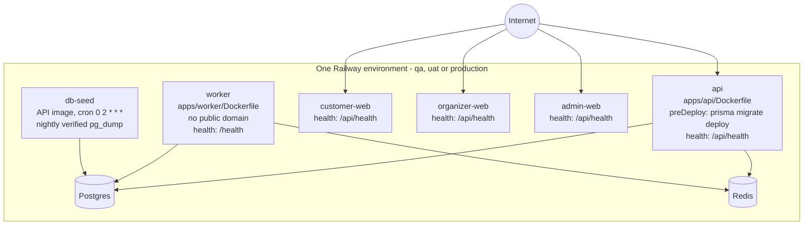

# ETicketsGo: Deployment and Operations

Status: current reference, rewritten 2026-11-01 against `main` at `d5144d3f`. It replaces the
P6.12 summary, which described a GitHub Container Registry pipeline with automatic `main`
deploys and `S3_*` and `SMTP_*` variables. None of those is how the system runs today.

For the live production state (commits, flags, blockers), see
[PRODUCT-CURRENT-STATE](PRODUCT-CURRENT-STATE.md). For the step-by-step Railway runbook, see
[deployment/RAILWAY_DEPLOYMENT_RUNBOOK.md](deployment/RAILWAY_DEPLOYMENT_RUNBOOK.md). For the
architecture, see [architecture/ARCHITECTURE.md](architecture/ARCHITECTURE.md).

## 1. Railway topology

One Railway project (`ETicketsGo`) holds three isolated environments: `qa`, `uat` and
`production`. Each environment has its own services, its own PostgreSQL and its own Redis, and
its own project token. A token for one environment cannot reach another.

| Service         | Config-as-code file                         | Notes                                                                                                                                                              |
| --------------- | ------------------------------------------- | ------------------------------------------------------------------------------------------------------------------------------------------------------------------ |
| `api`           | `deploy/railway/api.railway.json`           | The only migration executor (`preDeployCommand`). Deploy it first.                                                                                                 |
| `worker`        | `deploy/railway/worker.railway.json`        | Registers all repeatable BullMQ jobs at start. Deploy after `api`.                                                                                                 |
| `customer-web`  | `deploy/railway/customer-web.railway.json`  | Next.js. `NEXT_PUBLIC_API_URL` is inlined at build time.                                                                                                           |
| `organizer-web` | `deploy/railway/organizer-web.railway.json` | Next.js.                                                                                                                                                           |
| `admin-web`     | `deploy/railway/admin-web.railway.json`     | Next.js.                                                                                                                                                           |
| `db-seed`       | `deploy/railway/db-seed.railway.json`       | `prisma/seed-operation.ts`. Unset `SEED_OPERATION` means the nightly backup. Destructive operations need a time-boxed authorisation and are refused in production. |
| (fallback)      | `railway.json` (repository root)            | Describes the API, for a service created without a config path.                                                                                                    |

Every config file sets `numReplicas: 1`. The production replica count is not set in the
repository (unverified). The region is a single Railway region per environment.

Public hosts in production: `www.eticketsgo.com` (storefront), `organizer.eticketsgo.com` and
`admin.eticketsgo.com`. DNS is described in [deployment/CLOUDFLARE_DNS.md](deployment/CLOUDFLARE_DNS.md)
and [release/DNS-CLOUDFLARE-PLAN.md](release/DNS-CLOUDFLARE-PLAN.md).

## 2. Deploy procedure

1. **CI gate.** `ci.yml` on pull requests: format, lint, typecheck, circular dependencies,
   migrate and seed, unit tests, build, e2e. `security.yml`: npm audit, dependency review,
   secret scan, migration-drift gate. `mobile-ci.yml` for the Expo app.
2. **Nothing deploys on push.** Railway automatic deploys are off on every service.
   `deploy-railway.yml` runs only by manual dispatch, with the environment name typed again
   in `confirm`. Production can be dispatched only from `main`, and each environment also
   needs its `DEPLOY_ENABLED_<ENV>` repository variable. `deploy.yml` (image builds) is
   manual only.
3. **Pinned deploys for production.** Production releases deploy one named commit per service,
   in the order api, worker, customer-web, organizer-web, admin-web, waiting for `SUCCESS`
   after each. The owner runs these with a local deploy kit that requires a typed
   confirmation per service and commit (see
   [release/PROD-DEPLOY-OWNER-STEPS-2026-10-26.md](release/PROD-DEPLOY-OWNER-STEPS-2026-10-26.md)).
   `scripts/deploy/railway-deploy-and-wait.mjs` deploys the latest commit of the connected
   branch and is used for QA and UAT.
4. **Variables without a deploy.** A Railway variable change without `skipDeploys: true`
   builds the head of `main`, even with automatic deploys off. Every script that writes
   variables passes `skipDeploys: true` and then deploys explicitly.
   `scripts/deploy/validate-railway-config.mjs` fails the build if a variable write lacks it.
5. **Backup before a production migration.** Take a fresh `pg_dump`, restore it into a scratch
   database, and compare every table's row count and the payment sum with live before you
   deploy. Continue only when the restored copy matches.
6. **Verify with a fingerprint, not a green tick.** `scripts/deploy/verify-deployed.mjs`
   compares the commit each service runs with `origin/main` and asks each service for a fact
   only the new code produces. `scripts/deploy/qa-smoke-test.sh` checks the broad path on QA.
   `scripts/deploy/rotate-environment-secrets.mjs` compares SHA-256 fingerprints (never values)
   to prove two environments share no secret.
7. **Rollback.** Redeploy the previous deployment id of each service. Migrations are additive,
   so the previous code runs on the new schema. There are no down-migrations.

## 3. Backups and restore drill

- Nightly: the `db-seed` cron (02:00 UTC) takes a `pg_dump`, verifies it with
  `pg_restore --list`, and keeps the last copies on the Railway volume
  (`apps/api/prisma/backup.ts`).
- Off-platform copy: `apps/api/prisma/backup-offsite.ts`, off until `BACKUP_OFFSITE_BUCKET` and
  its credentials are set ([ops/OFFSITE-BACKUP.md](ops/OFFSITE-BACKUP.md)).
- Pre-deploy: a fresh dump plus a restore drill, as in step 5 above.
- Procedures, RPO and RTO: [deployment/RAILWAY_BACKUP_RECOVERY.md](deployment/RAILWAY_BACKUP_RECOVERY.md),
  [ops/BACKUP-RUNBOOK.md](ops/BACKUP-RUNBOOK.md), [ops/DISASTER-RECOVERY.md](ops/DISASTER-RECOVERY.md).

## 4. Configuration and feature flags

Names and defaults are from `apps/api/src/config/configuration.ts` unless noted. "Production"
is the state reported in [PRODUCT-CURRENT-STATE](PRODUCT-CURRENT-STATE.md) on 2026-10-30 to
2026-11-01; "unverified" means that document says so too, or it was not checked against the
running service. No values are listed here.

| Variable                                                    | Default        | Production                         | Effect                                                                  |
| ----------------------------------------------------------- | -------------- | ---------------------------------- | ----------------------------------------------------------------------- |
| `APP_ENV`                                                   | `LOCAL`        | `PRODUCTION`                       | Drives every boot check, the BullMQ prefix and the payment environment. |
| `PAYMENT_LIVE_ENABLED`                                      | `false`        | on for live Razorpay (unverified)  | Master switch for live ticket payments.                                 |
| `PAYMENT_ALLOW_LIVE_KEYS_LOWER_ENV`                         | `false`        | n/a                                | Lets a lower environment hold live keys (refused by default).           |
| `RAZORPAY_MODE`                                             | `test`         | `live` (unverified)                | Razorpay key mode, checked against the key prefix.                      |
| `RAZORPAY_ROUTE_ENABLED`                                    | `false`        | off                                | Razorpay Route transfers to organizers.                                 |
| `PAYOUT_EXECUTION_ENABLED`                                  | off (read raw) | off                                | Any provider transfer to organizers. Read in `settlement.service.ts`.   |
| `PAYOUT_HOLD_DAYS`                                          | `7`            | unverified                         | Days before a settlement becomes eligible.                              |
| `BILLING_ENABLED`                                           | `false`        | unset                              | Organizer subscription billing.                                         |
| `BILLING_PROVIDER`                                          | `disabled`     | unset                              | `disabled`, `mock` (LOCAL, DEV, QA only) or `providers`.                |
| `BILLING_LIVE_ENABLED`, `BILLING_LIVE_MARKETS`              | `false`, empty | unset                              | Production-only live billing; markets `US`, `IN`.                       |
| `CAMPAIGNS_ENABLED`                                         | `false`        | unset                              | Organizer marketing email campaigns.                                    |
| `COUPONS_ENABLED`                                           | `true`         | disabled (unverified)              | Coupon codes at checkout.                                               |
| `EMAIL_PROVIDER`                                            | `log`          | `ses`                              | `log`, `sendgrid` or `ses`.                                             |
| `SMS_ENABLED`                                               | `true`         | on                                 | Global SMS kill switch.                                                 |
| `SMS_PROVIDER`, `SMS_PROVIDER_BY_MARKET`                    | `log`, unset   | India routed to MSG91              | Per-market SMS provider (`log`, `twilio`, `msg91`).                     |
| `SMS_TRANSACTIONAL_TYPES`, `SMS_TRANSACTIONAL_MARKETS`      | unset, `IN`    | OTP plus three types, India only   | Which transactional messages may go by SMS, and where.                  |
| `NOTIFICATION_REMINDERS_ENABLED`                            | unset          | off                                | Show reminder messages.                                                 |
| `WHATSAPP_PROVIDER`, `WHATSAPP_PROVIDER_BY_MARKET`          | `log`, unset   | not live                           | `log`, `cloud` (Meta) or `msg91`.                                       |
| `PUSH_PROVIDER`, `WEBPUSH_PROVIDER`                         | `log`, `log`   | not live                           | Mobile push (`fcm`, `expo`); web push has only a log placeholder.       |
| `MFA_ENROLLMENT`                                            | `required`     | `deferred` (unverified)            | Whether admins must enrol in TOTP. Fee publish still needs MFA.         |
| `MFA_STEPUP_MINUTES`                                        | `10`           | unverified                         | Window for `@RequiresRecentMfa`.                                        |
| `TURNSTILE_MODE`                                            | `off`          | off (human check off)              | Cloudflare Turnstile on OTP and sign-up routes.                         |
| `SECRET_MANAGER_PROVIDER`                                   | `env`          | env variables for live keys        | `env`, `railway`, `aws`, `azure`, `gcp`.                                |
| `OBJECT_STORE_DRIVER`                                       | `postgres`     | unverified                         | `postgres` or Cloudflare `r2`.                                          |
| `DOMAIN_EVENT_DELIVERY_MODE`                                | `in_process`   | unverified                         | `in_process`, `outbox`, `dual_write_shadow`.                            |
| `DOMAIN_EVENT_OUTBOX_DISPATCH_ENABLED`                      | off            | unverified                         | Worker outbox dispatch.                                                 |
| `INVENTORY_LOCKS_ENABLED`, `INVENTORY_LOCKS_MODE`           | off, `shadow`  | unverified                         | Redis seat locks (ADR-039).                                             |
| `BOOKING_ORCHESTRATOR_ENABLED`, `BOOKING_ORCHESTRATOR_MODE` | off, `shadow`  | unverified                         | Booking workflow orchestrator (ADR-042).                                |
| `INVENTORY_SOURCING_ENABLED`, `INVENTORY_SYNC_ENABLED`      | off            | unverified                         | External inventory providers and sync (ADR-037, ADR-040).               |
| `OFFLINE_CHECKIN_ENABLED`                                   | off            | unverified                         | Offline gate devices.                                                   |
| `AI_PROVIDER`                                               | `disabled`     | unverified                         | `disabled`, `openai`, `anthropic`.                                      |
| `PILOT_MODE`                                                | unset          | unverified                         | Controlled pilot limits and automatic pause.                            |
| `TAX_PROVIDER`                                              | `manual`       | `manual`; India GST rules inactive | Tax source; read in `apps/api/src/tax/tax.module.ts`.                   |

The billing gate and the other boot checks are listed in
[architecture/ARCHITECTURE.md](architecture/ARCHITECTURE.md#56-configuration-gates-fail-closed-at-boot).
Required secrets include `DATABASE_URL`, `REDIS_URL`, `JWT_ACCESS_SECRET`, `QR_SIGNING_SECRET`,
`PAYMENT_WEBHOOK_SECRET`, the provider keys and webhook secrets, `MFA_ENCRYPTION_KEY` and
`PAYOUT_BANK_ENCRYPTION_KEY`. They are set in Railway variables and never committed. Example
files without values: `deploy/railway/env/*.env.example`.

## 5. Security controls (summary)

- Fail-closed boot validation per environment (live keys, webhook secrets, CORS, SES, SMS,
  billing, object store).
- Server-chosen payment provider, amount and currency. SAQ-A posture: no card data reaches the
  platform.
- Signature verification on every payment, billing and delivery webhook (MSG91: path secret),
  plus deduplication tables.
- JWT access tokens with rotating refresh tokens and reuse detection. TOTP MFA and step-up for
  admin money and configuration actions. Per-permission `AdminGrant` rows read on every
  request.
- Tenant checks in `OrgAccessService`. `@OrganizerOnly` keeps staff out of organizer money and
  identity routes.
- Bank details encrypted with AES-256-GCM and verified by a second person. Provider transfers
  behind `PAYOUT_EXECUTION_ENABLED`.
- OTP send guard with per-number and per-market budgets. Throttling on authentication routes.
  Optional Turnstile and Play Integrity human checks.
- Audit log for privileged actions. Hashed destinations in the suppression list.
- Details: [SECURITY-HANDBOOK](SECURITY-HANDBOOK.md), [security/ADMIN-MFA.md](security/ADMIN-MFA.md),
  [security/ADMIN-PERMISSION-MATRIX.md](security/ADMIN-PERMISSION-MATRIX.md).

## 6. Other deployment targets

`docker-compose.yml` runs PostgreSQL and Redis for local development (`npm run dev`).
`docker-compose.prod.yml` and its overlays build and run the full stack on any Docker host
([guides/DEPLOYMENT.md](guides/DEPLOYMENT.md)). An AWS topology is described in
`docs/p6/P6.1-CLOUD-DEPLOYMENT.md`. Neither is in use.
