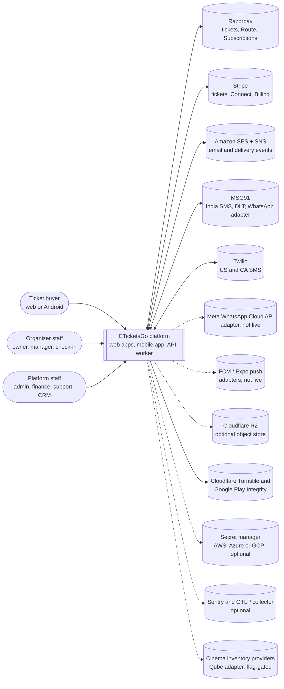
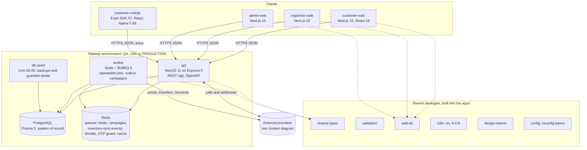

# ETicketsGo: Architecture (as built)

Status: current reference, written 2026-11-01 against `main` at `d5144d3f`. Production
commits on that date, as reported by the release owner: api, worker and admin-web on
`702a51bc`; customer-web and organizer-web on `76c304da`. For the live product and flag state,
see [PRODUCT-CURRENT-STATE](../PRODUCT-CURRENT-STATE.md).

This document describes what the code does today. Where a statement depends on configuration,
it names the variable and its default from `apps/api/src/config/configuration.ts`.

Companion documents: [DATA-MODEL](DATA-MODEL.md) · [FLOWS](FLOWS.md) ·
[DEPLOYMENT-GUIDE](../DEPLOYMENT-GUIDE.md) · [REVIEW-GUIDE](REVIEW-GUIDE.md) ·
[EVENT-CATALOGUE](EVENT-CATALOGUE.md) · ADR index [ADR-STATUS](../adr/ADR-STATUS.md)

## 1. Summary

- **Shape:** a modular monolith. One NestJS API (`apps/api`) and one background worker
  (`apps/worker`) share one PostgreSQL database and one Redis. Three Next.js web apps and one
  Expo mobile app call the API over HTTPS REST (`/api` prefix).
- **Monorepo:** Turborepo plus npm workspaces, strict TypeScript, Node 20 (`.nvmrc`,
  `engines.node >=20`, `node:20-alpine` images).
- **System of record:** PostgreSQL through Prisma 5 (139 models, 151 migrations). Redis holds
  only data that can be rebuilt: BullMQ queues, rate-limit counters, OTP send guards, cache,
  and the optional distributed seat locks.
- **Hosting:** Railway, one project with three isolated environments (QA, UAT, PRODUCTION).
  Each environment has its own Postgres and Redis.
- **Markets:** India (INR, Razorpay, MSG91 SMS) and the USA and Canada (USD and CAD, Stripe,
  Twilio SMS). The server picks the payment provider from the currency. The client never
  chooses it.

## 2. System context (C4 level 1)

Dotted lines are integrations that exist in code but are optional or switched off by default.
The two-way lines carry webhooks back into the platform (payment, billing and delivery
events).

## 3. Containers (C4 level 2)

### 3.1 Applications

| App                    | Technology                                         | Responsibility                                                                                                                                                                  |
| ---------------------- | -------------------------------------------------- | ------------------------------------------------------------------------------------------------------------------------------------------------------------------------------- |
| `apps/api`             | NestJS 11 (Express 5), Prisma 5, `@sentry/node` 10 | All business logic and all writes. REST under `/api`, OpenAPI. Runs `prisma migrate deploy` as its Railway `preDeployCommand` (single migrator).                                |
| `apps/worker`          | Node, BullMQ 5, reuses API services                | Repeatable jobs on the `holds` queue, organizer campaigns on the `campaigns` queue, inventory sync on `inventory-sync-events`. `/health`, `/ready`, `/metrics` on its own port. |
| `apps/customer-web`    | Next.js 15, React 18, Tailwind                     | Storefront: discovery, event and film pages, seat selection, checkout, tickets, account, guest booking access.                                                                  |
| `apps/organizer-web`   | Next.js 15                                         | Organizer console: events, sessions, venues and spaces, seating, pricing, orders, check-in, payouts, audience, campaigns, billing.                                              |
| `apps/admin-web`       | Next.js 15                                         | Platform console: approvals, refunds, settlements, fee schedules, fee policies, billing catalogue, CRM, audit, notifications, admin grants.                                     |
| `apps/customer-mobile` | Expo SDK 57, expo-router, React Native 0.86, EAS   | Android buyer app: browse, event and film pages, seat map, checkout, tickets, account. REST via axios with single-flight refresh (`src/services/api-client.ts`).                |
| `apps/e2e`             | Playwright                                         | End-to-end tests. Specs named `qa-*.spec.ts` target a deployed environment only when `QA_VALIDATE=1`.                                                                           |

### 3.2 Shared packages

| Package                  | Purpose                                                                                                                                         |
| ------------------------ | ----------------------------------------------------------------------------------------------------------------------------------------------- |
| `packages/shared-types`  | Framework-free domain types and pure rules (admin permissions, markets, settlement transitions, fee and finance math). Unit-tested.             |
| `packages/validation`    | Shared request schemas used by the API and the web apps.                                                                                        |
| `packages/web-kit`       | Shared Next.js client: API client, hooks, UI kit, app shell, fonts.                                                                             |
| `packages/i18n`          | Message catalogue for `en` and `fr-CA` (`src/locales.ts`). Used by the storefront, checkout, receipts and email. A missing key fails the build. |
| `packages/design-tokens` | CSS variable tokens, themes and the Tailwind preset.                                                                                            |
| `packages/config`        | Shared `tsconfig` bases (base, nest, next).                                                                                                     |

### 3.3 BullMQ queues and jobs (from `apps/worker/src/main.ts`)

The queue prefix is derived from `APP_ENV` (`bullPrefix`), so environments never share a
keyspace even on a shared Redis. Every job is idempotent and safe to repeat.

| Queue                   | Job                                                 | What it does                                                                                       |
| ----------------------- | --------------------------------------------------- | -------------------------------------------------------------------------------------------------- |
| `holds`                 | `expire-holds`                                      | Releases expired seat and ticket holds.                                                            |
| `holds`                 | `dispatch-notifications`                            | Sends due `Notification` rows (default every 5 s).                                                 |
| `holds`                 | `notification-fallbacks`                            | Opens a paid fallback channel when free channels produced nothing.                                 |
| `holds`                 | `notification-callback-replay`                      | Re-applies delivery events that were waiting for correlation.                                      |
| `holds`                 | `notification-reminders`                            | Show reminders (only when `NOTIFICATION_REMINDERS_ENABLED`).                                       |
| `holds`                 | `notification-cancellation-fanout`                  | Tells buyers that a show was cancelled.                                                            |
| `holds`                 | `cancellation-refunds`                              | Refunds bookings of cancelled shows.                                                               |
| `holds`                 | `event-sellability-sweep`                           | Warns organizers about events that cannot sell (hourly).                                           |
| `holds`                 | `process-webhooks`                                  | Retries stored Stripe and Razorpay ticket-payment webhooks.                                        |
| `holds`                 | `reversal-reconcile`                                | Read-only reconciliation of settlement reversals.                                                  |
| `holds`                 | `inventory-sync-sweep`                              | Polling and repair for external inventory (flag-gated).                                            |
| `holds`                 | `outbox-dispatch`, `outbox-maintenance`             | Transactional outbox dispatch and lease or retention upkeep (flag-gated).                          |
| `holds`                 | `reconcile-finance`                                 | Finance reconciliation and discrepancy detection.                                                  |
| `holds`                 | `payout-runs`                                       | Hourly: creates `SCHEDULED` payout ledger rows where `autoGenerate` is set. Never moves money.     |
| `holds`                 | `prune-tokens`                                      | Deletes expired refresh and one-time tokens.                                                       |
| `holds`                 | `billing-sweep`                                     | Subscription clock events, missed-renewal recovery, dunning (default 15 min).                      |
| `holds`                 | `billing-price-check`                               | Daily: compares the billing catalogue with Stripe prices. Reports only.                            |
| `campaigns`             | `campaign-tick`, `campaign-expand`, `campaign-send` | Organizer email campaigns, with their own rate limit (`CAMPAIGN_SEND_RATE_PER_SECOND`, default 5). |
| `inventory-sync-events` | (one processor)                                     | Processes raw provider events queued by the API sync ingestion.                                    |

The API produces jobs on `inventory-sync-events` (`apps/api/src/inventory/sync/`). The API's
`holds` queue provider is `apps/api/src/ops/holds-queue.provider.ts`. There is no separate
scheduler service: the worker registers the schedules at start-up.

## 4. API module map (`apps/api/src`)

Each folder is one NestJS module (sometimes several) registered in `app.module.ts`.
"Global" means other modules can inject it without importing it.

| Folder                               | Responsibility                                                                                                                                              |
| ------------------------------------ | ----------------------------------------------------------------------------------------------------------------------------------------------------------- |
| `admin`                              | Admin console endpoints, including fee schedules (`fee-schedules.*`) and platform fee policies.                                                             |
| `ai`, `ai-growth`                    | Provider-neutral AI ports with no-op defaults (`AI_PROVIDER=disabled`); read-only organizer and admin AI insights.                                          |
| `analytics`, `reports`               | Organizer and admin analytics and reports, scoped per organization and per currency.                                                                        |
| `attendees`                          | Attendee identity on tickets and the attendee lists.                                                                                                        |
| `audit`                              | `AuditService.record` and `recordInTransaction` into `AuditLog`.                                                                                            |
| `auth`                               | Email and password, phone OTP, email codes, refresh-token rotation, organizer handoff, admin MFA (`auth/mfa`).                                              |
| `billing`                            | Organizer plans, prices, entitlements, subscriptions, invoices, credit packs; Stripe Billing and Razorpay Subscriptions. Global (`@RequiresEntitlement`).   |
| `bookings`                           | Quote, hold, booking, guest access, references; orchestration and compensation sub-modules (flag-gated).                                                    |
| `cache`, `redis`, `prisma`           | Infrastructure: Redis-backed cache, Redis client, the single Prisma gateway.                                                                                |
| `campaigns`                          | Organizer email campaigns: drafts, audiences, send, link tracking, analytics.                                                                               |
| `checkins`                           | Online check-in and offline gate devices (signed manifests, offline reconciliation).                                                                        |
| `cinemas`, `movies`, `shows`         | Cinema domain: cinemas, films, shows and seat overrides.                                                                                                    |
| `commerce`                           | Add-ons and bundles with their own stock.                                                                                                                   |
| `common`                             | Error envelope, guards and decorators, correlation id, logging, the domain event bus and outbox (`common/domain-events`).                                   |
| `config`                             | Zod-validated environment and the fail-closed boot checks.                                                                                                  |
| `counter`                            | Box-office sales and cash collection.                                                                                                                       |
| `coupons`                            | Coupon codes (`COUPONS_ENABLED`).                                                                                                                           |
| `crm`                                | Admin sales CRM for organizer acquisition (`Crm*` tables).                                                                                                  |
| `discovery`, `recommendations`       | Search and browse by location (offline GeoNames reverse geocoder), and "you might also like".                                                               |
| `engagement`                         | Follows, scoped communication consent, signed unsubscribe links, organizer audience view.                                                                   |
| `events`                             | Events, sessions, ticket types, event images.                                                                                                               |
| `experience`                         | Experience type to capability mapping (not imported in `app.module.ts`; used as a library).                                                                 |
| `finance`                            | Finance helpers used by payments and payouts (no module of its own).                                                                                        |
| `health`, `metrics`, `observability` | `/health`, `/ready`, Prometheus `/metrics`, Sentry and optional OpenTelemetry.                                                                              |
| `human-check`                        | `@RequiresHumanCheck`: Cloudflare Turnstile (web) and Google Play Integrity (Android). `TURNSTILE_MODE` default `off`.                                      |
| `inventory`                          | Inventory strategies, external sourcing, sandbox, sync, and Redis seat locks (ADR-037 to ADR-040).                                                          |
| `notifications`                      | Producers, policy, routing, channels and transports, delivery receipts, suppression, cost, feed, web push.                                                  |
| `ops`                                | Operational endpoints, the `holds` queue producer, operator alerts.                                                                                         |
| `organizations`                      | Organizations, members, invitations, organizer identity.                                                                                                    |
| `payments`                           | Ticket payments: provider factory and routing, webhooks, Stripe Connect, Razorpay Route, settlements, disputes, reconciliation, readiness and launch gates. |
| `payouts`                            | Payout accounts (maker-checker), payout runs, payout allocations, Unified Finance read model.                                                               |
| `pilot`                              | Controlled pilot limits and the automatic pause.                                                                                                            |
| `pricing`                            | Line pricing strategies, fee tiers from `FeeRule`, fee policy resolution, India cinema price ceilings.                                                      |
| `receipts`                           | Receipts, invoices and credit notes with their own numbering.                                                                                               |
| `refunds`                            | Refund requests, approval, execution and cancellation refunds.                                                                                              |
| `reviews`                            | Ratings and reviews.                                                                                                                                        |
| `secrets`                            | `SecretManager` (env, railway, aws, azure, gcp). Global.                                                                                                    |
| `sharing`                            | Shared access to bookings and resources.                                                                                                                    |
| `spaces`, `venues`                   | Venues and their bookable spaces (screens, halls), seat maps and zones.                                                                                     |
| `storage`                            | Object store chosen at boot: `postgres` (default) or Cloudflare `r2`.                                                                                       |
| `support`                            | Support messages with `ETG-SUP` references.                                                                                                                 |
| `tax`                                | Tax provider seam (`TAX_PROVIDER`, default `manual` = `TaxRule` table). Not imported in `app.module.ts` directly.                                           |
| `tenancy`                            | `OrgAccessService` and `@OrganizerOnly`. Global.                                                                                                            |
| `tickets`, `wallet`                  | Tickets and signed QR codes; wallet-pass projections.                                                                                                       |
| `users`                              | Profile, account deletion, preferences.                                                                                                                     |

## 5. Cross-cutting mechanisms

### 5.1 Authentication

- **Tokens:** a short JWT access token (`JWT_ACCESS_TTL`, default 900 s) and a rotating refresh
  token stored as a `RefreshToken` row (`JWT_REFRESH_TTL`, default 30 days). Reusing a rotated
  token outside a short grace window revokes every active refresh token of that user and logs
  `AUTH_TOKEN_REUSE_DETECTED` (`apps/api/src/auth/auth.service.ts`).
- **Sign-in methods:** email and password, email codes, phone OTP (`auth/phone-otp.service.ts`,
  see [FLOWS](FLOWS.md) section 5), and a one-time handoff from the storefront to the organizer
  console (`AuthHandoff`).
- **Admin MFA:** TOTP with an encrypted secret (`MFA_ENCRYPTION_KEY`), recovery codes, and a
  break-glass path (`MFA_BREAK_GLASS_EMAIL` plus nonce, audited). `MFA_ENROLLMENT` is
  `required` by default. `@RequiresRecentMfa()` asks for a step-up within `MFA_STEPUP_MINUTES`
  (default 10) on sensitive actions such as fee schedule publish and settlement approve and
  release.
- **Global guard order** (`app.module.ts`): Maintenance, Throttler, JwtAuth, Mfa,
  OrganizerOnly, Roles, AdminPermission.

### 5.2 Authorization (RBAC)

- `Role` on the user and on each `OrganizationMember`: `CUSTOMER, ORGANIZER_OWNER,
ORGANIZER_MANAGER, CHECKIN_STAFF, ADMIN, SUPER_ADMIN`.
- Back-office capabilities are `AdminGrant` rows (one per user and permission), read from the
  database on every request. The catalogue and presets are in
  `packages/shared-types/src/admin-permissions.ts`; the matrix is
  [ADMIN-PERMISSION-MATRIX](../security/ADMIN-PERMISSION-MATRIX.md). Routes declare
  `@RequiresAdmin(<permission>)`.
- Separation of duties: a bank-account verifier needs `PAYOUT_MANAGE` and `BANK_VERIFY` and
  cannot be the person who entered the details or a member of that organization
  (`apps/api/src/payouts/payout-accounts.service.ts`).

### 5.3 Multi-tenancy

- Tenancy is per `Organization`. `OrgAccessService` (`apps/api/src/tenancy/org-access.service.ts`)
  requires an ACTIVE membership with an allowed role.
- Platform staff reach organizer data only where the call site names a platform policy, and
  each attempt is audited (`PLATFORM_ORGANIZER_ACCESS_ALLOWED` or `_DENIED`). `@OrganizerOnly`
  keeps staff out of money and identity routes completely.
- Scoping is explicit in service code. There is no PostgreSQL row-level security and no
  Prisma middleware that adds the tenant filter. Reviewers should treat each query's
  `organizationId` filter as the control.

### 5.4 Domain events and the transactional outbox

- `DomainEventsModule` (`apps/api/src/common/domain-events/`) gives a typed, transaction-aware
  in-process bus (ADR-038). Events are listed in [EVENT-CATALOGUE](EVENT-CATALOGUE.md).
- `DOMAIN_EVENT_DELIVERY_MODE` is `in_process` by default. `outbox` and `dual_write_shadow`
  record `OutboxEvent` rows in the same transaction (ADR-041). The worker's `outbox-dispatch`
  job claims them with `FOR UPDATE SKIP LOCKED` and leases, and `ProcessedDomainEvent`
  (unique on event and handler) makes each handler run at most once. Dispatch also needs
  `DOMAIN_EVENT_OUTBOX_DISPATCH_ENABLED`; production refuses `outbox` mode without it.

### 5.5 Idempotency and replay protection

- **Client retries:** the `Idempotency-Key` header on booking, counter-sale and event-write
  routes. `IdempotencyRecord` is unique on (scope, key) and stores a request hash and the
  response. `Booking.idempotencyKey` is unique.
- **Ticket payment webhooks:** `WebhookEvent` is unique on (provider, providerEventId) and
  stores a payload hash. Already `PROCESSED` or `PROCESSING` events are answered as
  duplicates. The worker's `process-webhooks` job retries `RECEIVED` and `FAILED` rows until
  `DEAD_LETTER`. (`AWAITING_CORRELATION` exists in the enum but only the delivery-event path
  uses that idea.)
- **Billing webhooks:** `BillingWebhookEvent` is unique on (provider, providerEventId). The
  service re-fetches the payment and subscription from the provider before it changes any
  state.
- **Delivery events:** a ledger unique on (provider, eventId). SNS messages are
  signature-verified (`notifications/delivery/webhook/sns-verifier.ts`). Twilio and Meta
  signatures are checked. MSG91 has no signature, so its callback URL carries a path secret.
- **Money calls:** the intent row (`RefundProviderAttempt`, `SettlementTransferAttempt`) is
  written before the provider call, with a stable idempotency key. An exception is recorded
  as an unknown outcome and goes to reconciliation, never retried blind.

### 5.6 Configuration gates (fail closed at boot)

`loadConfig()` parses the environment with zod and then runs the `assert*` checks in
`configuration.ts`. Any failure stops the process before it serves traffic. The main checks:

| Check                                                            | What it refuses (examples)                                                                                  |
| ---------------------------------------------------------------- | ----------------------------------------------------------------------------------------------------------- |
| `assertProductionHardening`                                      | Missing or localhost `CORS_ORIGINS` and other unsafe defaults in production.                                |
| `assertAdminMfaArmed`                                            | Admin MFA required without an encryption key.                                                               |
| `assertPaymentEnvironmentKeySafety`                              | Live payment keys outside production (unless `PAYMENT_ALLOW_LIVE_KEYS_LOWER_ENV`), test keys in production. |
| `assertPaymentActivationPending`                                 | Live payment configuration while `PAYMENT_LIVE_ENABLED` is false.                                           |
| `assertRazorpayConsistency`                                      | Key, mode and webhook secret that do not belong together.                                                   |
| `assertBillingConfiguration`                                     | See below.                                                                                                  |
| `assertNotificationConfigConsistency`, `dltConfigContradictions` | SMS and WhatsApp routing without the provider and DLT template configuration it needs.                      |
| `assertSesProductionReadiness`, `assertDeliverabilityHardening`  | Production email without SES, configuration set or SNS topic list.                                          |
| `assertObjectStoreConsistency`                                   | `OBJECT_STORE_DRIVER=r2` without all R2 variables.                                                          |
| `assertPlatformConfigConsistency`                                | Contradictory platform flags (for example outbox mode without dispatch in production).                      |

**Billing gate** (`billingConfigurationErrors`):

- Everywhere: `BILLING_PROVIDER=mock` outside LOCAL, DEV and QA; `BILLING_ENABLED=true` with
  `BILLING_PROVIDER=disabled`; billing in STAGING; any live flag or live key outside
  production.
- Production: `BILLING_ENABLED=true` or `BILLING_PROVIDER=providers` without
  `BILLING_LIVE_ENABLED=true`; live enabled with an empty `BILLING_LIVE_MARKETS` or a market
  other than `US` or `IN`; `*_REF` secret references for the four billing secrets; a listed
  market without its own billing keys (no fallback to the ticket keys); any non-live billing
  key.
- `apps/api/src/billing/billing-live-gate-safety.spec.ts` proves the live gate stays shut
  while `BILLING_ENABLED` is off.

Flags read outside the zod schema: `PAYOUT_EXECUTION_ENABLED` is read directly in
`apps/api/src/payments/settlement/settlement.service.ts` and is off unless it equals `true`.
The full flag table is in [DEPLOYMENT-GUIDE](../DEPLOYMENT-GUIDE.md#4-configuration-and-feature-flags).

### 5.7 Audit log

`AuditService.record` writes `AuditLog` rows (actor, organization, action, entity, metadata,
correlation id, IP). `record()` swallows its own write errors so that auditing never breaks the
main operation. Power-changing actions (fee schedule publish, admin grants, billing) use
`recordInTransaction()`, so the audit row and the change commit together. The table is
append-only by convention: no production code updates or deletes it, but no database trigger
or grant enforces this.

### 5.8 Notifications pipeline

- **Producers** call `NotificationService.send`, `sendCritical(tx)` (in the caller's
  transaction), `fanOutCritical` or `schedule` (`apps/api/src/notifications/notification.service.ts`).
  Each writes a `Notification` row.
- **Policy** (`notifications/policy/`) chooses channels from consent, marketing consent and the
  transactional SMS lists (`SMS_TRANSACTIONAL_TYPES`, `SMS_TRANSACTIONAL_MARKETS`, default `IN`).
- **Dispatch:** the worker's `dispatch-notifications` job sends due rows. Before sending it
  checks `SuppressedDestination` (hashed destination). Each attempt is a `NotificationDelivery`
  row.
- **Routing per market** (`notifications/channels/notification-provider.resolver.ts`):
  `SMS_PROVIDER_BY_MARKET` (falls back to `SMS_PROVIDER`, default `log`) and
  `WHATSAPP_PROVIDER_BY_MARKET`.
- **Transports:** email `log | sendgrid | ses`; SMS `log | twilio | msg91`; WhatsApp
  `log | cloud | msg91`; push `log | fcm | expo`; web push only a log placeholder (`vapid` is
  not wired and falls back to log).
- **Delivery correlation:** provider webhooks (SES via SNS, Twilio, MSG91, WhatsApp Cloud) are
  stored in a ledger and matched to `NotificationDelivery` or `PhoneOtp` by provider message
  id. Unmatched events wait as `AWAITING_CORRELATION` and the worker replays them. Bounces and
  complaints add the destination to `SuppressedDestination`.
- **Campaigns** use a separate path and queue (see [FLOWS](FLOWS.md) section 7).

### 5.9 Internationalization

`packages/i18n` holds `en` and `fr-CA`. The storefront, checkout, receipts and email render from
it. Currency follows the venue, never the visitor. Phone numbers carry the market's calling
code from `Market` configuration.

### 5.10 Observability

- **Metrics:** Prometheus at `GET /api/metrics` on the API (bearer-token guard,
  `metrics/metrics-access.guard.ts`) and at `/metrics` on the worker's port.
- **Errors:** Sentry in the API (`observability/sentry.ts`), the worker (manual capture) and the
  mobile app (`@sentry/react-native`). Each is a no-op without `SENTRY_DSN`. The three web apps
  have no Sentry.
- **Tracing:** OpenTelemetry starts only when `OTEL_EXPORTER_OTLP_ENDPOINT` is set
  (`observability/tracing.ts`).
- **Logs:** one log line per request (`common/logging.interceptor.ts`, `common/http-observation.*`)
  with redaction, and an `x-correlation-id` that is also stored on audit rows.
- **Health:** `/api/health` (liveness) and `/api/ready` (PostgreSQL and Redis). The worker
  serves `/health` and `/ready` on its own port.
- **Operator alerts:** `OpsAlertsModule` emails `OPS_ALERT_EMAILS`.

### 5.11 Secrets and object storage

- `SECRET_MANAGER_PROVIDER` is `env` (default), `railway`, `aws`, `azure` or `gcp`
  (`apps/api/src/secrets/`). Payment configuration rows store secret references, not values.
  Billing secrets must be set directly in production (references are refused).
- `OBJECT_STORE_DRIVER` is `postgres` by default (images in the `StoredObject` table, served by
  the API) or `r2` (Cloudflare R2 through the S3 client).

## 6. Known structural limits

These limits are summarized here and tracked in [REVIEW-GUIDE](REVIEW-GUIDE.md#3-known-risks-limitations-and-open-decisions):
single region and a single Postgres per environment; tenancy enforced in application code
only; audit log append-only by convention; outbox and distributed locks built but off by
default; web push not wired; Node 20 runtime.
