# ETicketsGo: Data Model (as built)

Status: current reference, generated 2026-11-01 from `apps/api/prisma/schema.prisma` on `main`
(`d5144d3f`). Audience: solution architects and senior engineers.

| Fact                     | Value (from the repository)                                                  |
| ------------------------ | ---------------------------------------------------------------------------- |
| Prisma models            | **139** (`grep -c '^model ' apps/api/prisma/schema.prisma`)                  |
| Prisma enums             | **104** (`grep -c '^enum ' apps/api/prisma/schema.prisma`)                   |
| Migrations               | **151** folders in `apps/api/prisma/migrations` (plus `migration_lock.toml`) |
| First / latest migration | `20260712080238_init` / `20261030100000_fee_schedule_drafts`                 |
| Database                 | PostgreSQL, accessed only through Prisma 5 (`apps/api/src/prisma`)           |
| Money                    | Integer minor units (`*Minor` columns) plus an ISO `currency` column         |

How to read the diagrams:

- A small script that reads the schema generated the diagrams. They show primary keys, foreign
  keys (fields named in a Prisma `@relation(fields: [...])`), unique keys, and the important
  status, money, currency and version columns. They do not show every column (at most 16 per
  model).
- `"logical ref, no FK"` marks a scalar id column (for example `organizationId`) that has **no**
  Prisma relation and so **no database foreign key**. Several newer domains (billing, growth,
  CRM, finance ledgers) do this on purpose. Service code enforces these references.
- A relationship to a model in another domain is drawn only when the target is a hub (`User`,
  `Organization`, `Event`, `EventSession`, `Booking`, `Payment`, `Refund`, `Settlement`,
  `Ticket`, `Venue`, `Screen`). The hub then shows as an empty box in that diagram.
- `||--o{` means one parent to zero or more children. `|o` on the parent side means the
  foreign key can be null. `o|` on the child side means the foreign key is unique (one-to-one).
- To check a claim: `npx prisma validate --schema apps/api/prisma/schema.prisma`, then read the
  model with `grep -n -A40 '^model <Name> {' apps/api/prisma/schema.prisma`.

Related: [ARCHITECTURE](ARCHITECTURE.md) · [FLOWS](FLOWS.md) ·
[BOOKING-STATE-TRANSITION-MATRIX](BOOKING-STATE-TRANSITION-MATRIX.md) ·
[EVENT-CATALOGUE](EVENT-CATALOGUE.md) · [REVIEW-GUIDE](REVIEW-GUIDE.md)

## 1. Domain diagrams

Each of the 139 models is in exactly one domain below. The generator fails if a model is
missing or listed twice.

### Identity and access

Models (12): `User`, `AccountInvitation`, `PhoneOtp`, `PasswordResetToken`, `AuthHandoff`, `EmailVerificationCode`, `RefreshToken`, `RefreshTokenMfa`, `AdminMfaCredential`, `AdminMfaRecoveryCode`, `AdminMfaBreakGlassUse`, `AdminGrant`.

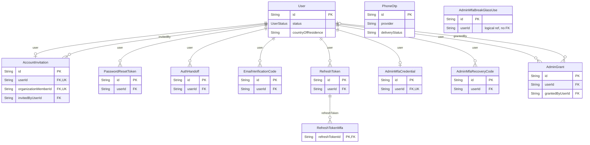

### Organizations and venues

Models (7): `Organization`, `OrganizationMember`, `OrganizationImage`, `Venue`, `VenueArea`, `Cinema`, `Screen`.

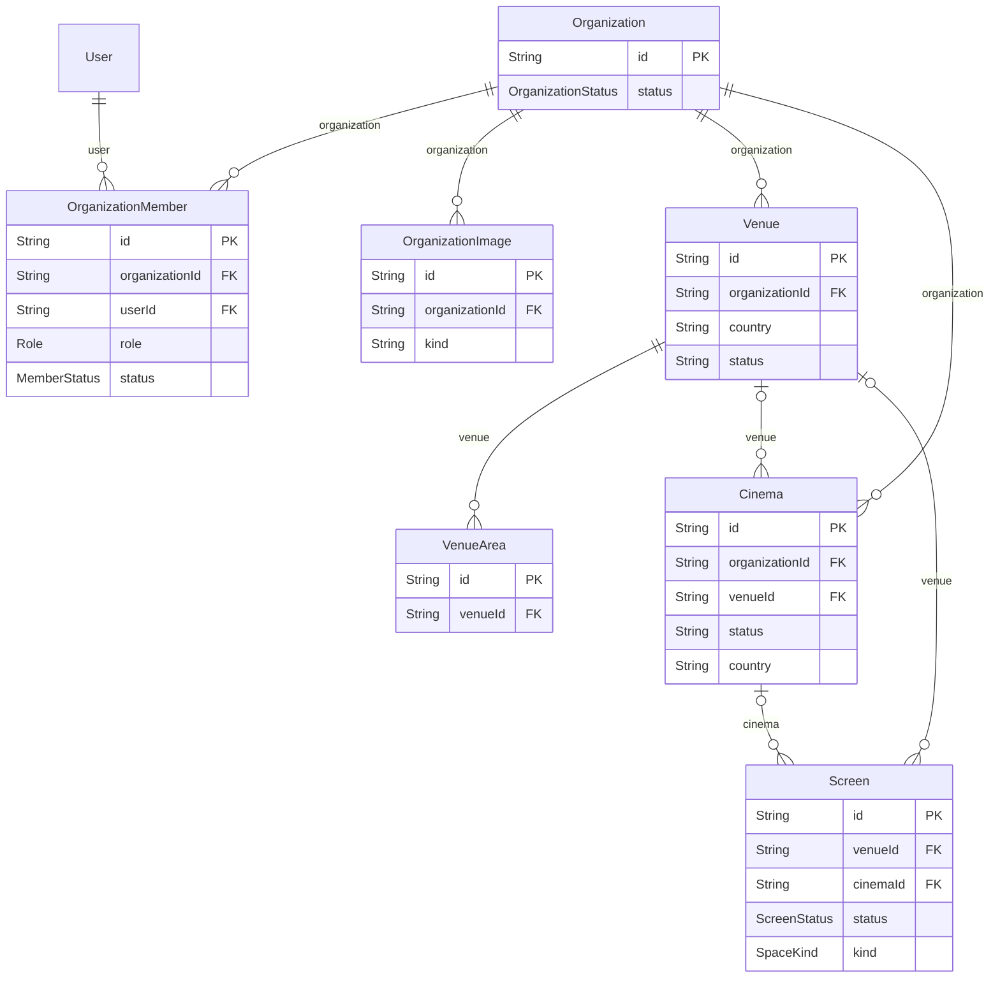

### Events and sessions

Models (13): `Event`, `EventImage`, `EventImageVariant`, `StoredObject`, `Movie`, `Review`, `EventSession`, `TicketType`, `TicketInventory`, `AddOn`, `AddOnInventory`, `Bundle`, `BundleItem`.

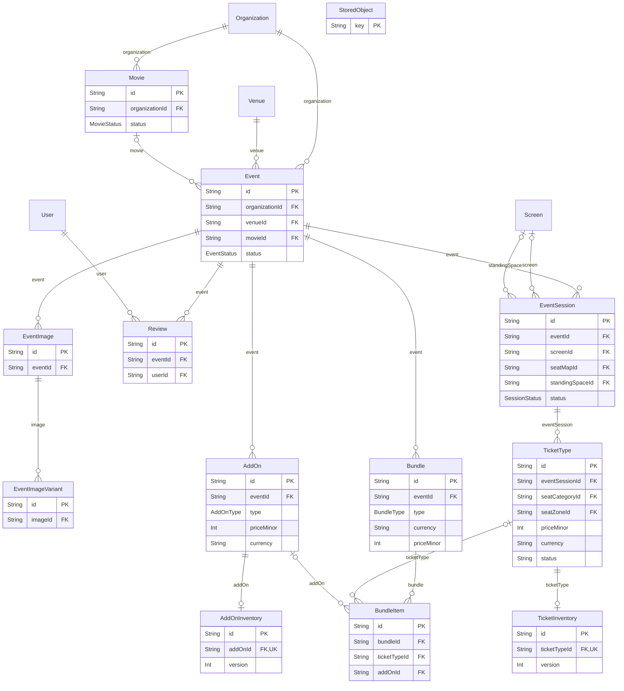

### Seating

Models (8): `SeatMap`, `SeatCategory`, `SeatSection`, `SeatRow`, `Seat`, `ShowSeat`, `SeatZone`, `ShowZone`.

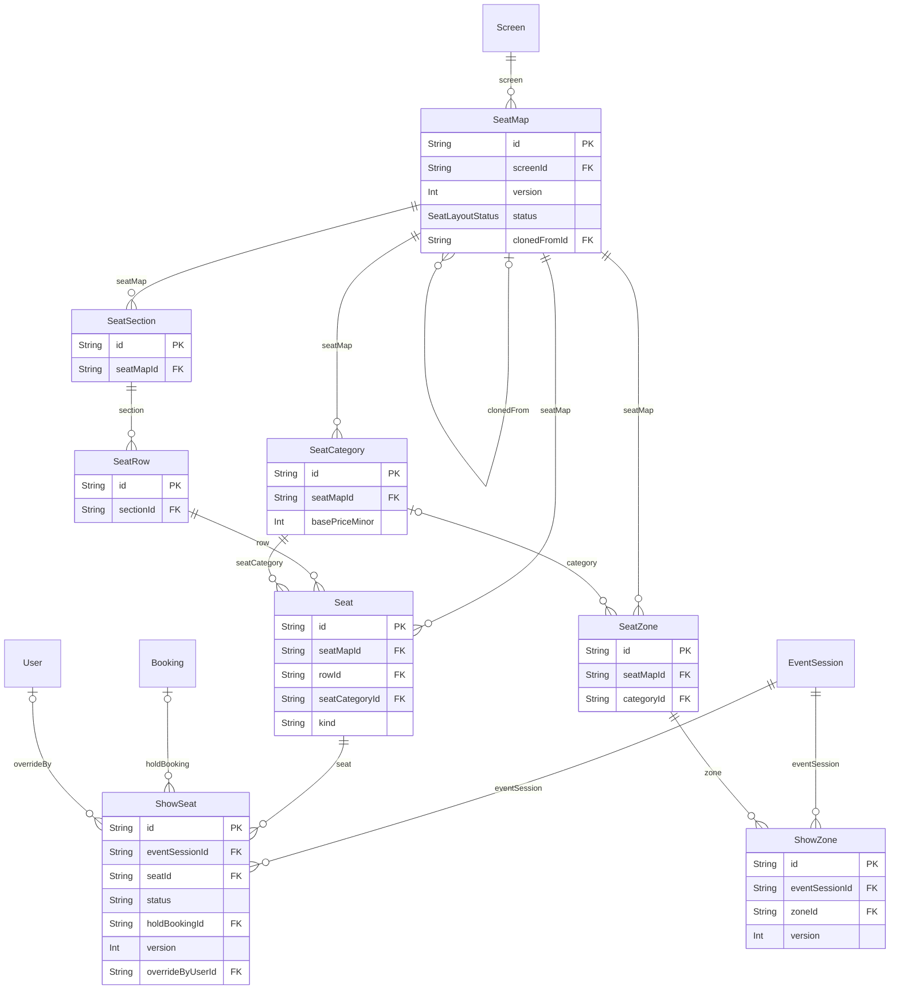

### External inventory sourcing and sync

Models (4): `ProviderMapping`, `ProviderSyncCheckpoint`, `ProviderInventoryState`, `RawProviderEvent`.

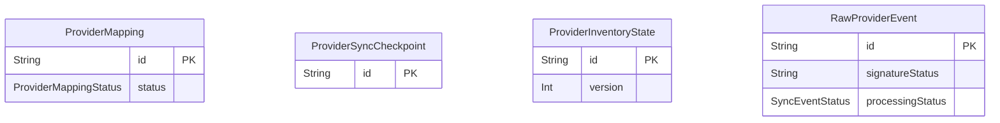

### Pricing, fees and tax

Models (9): `FeeRule`, `FeeScheduleDraft`, `PlatformFeePolicy`, `PlatformFeePolicyEvent`, `Coupon`, `TaxRule`, `BookingTaxLine`, `CinemaPricingPolicy`, `RegulatoryDocument`.

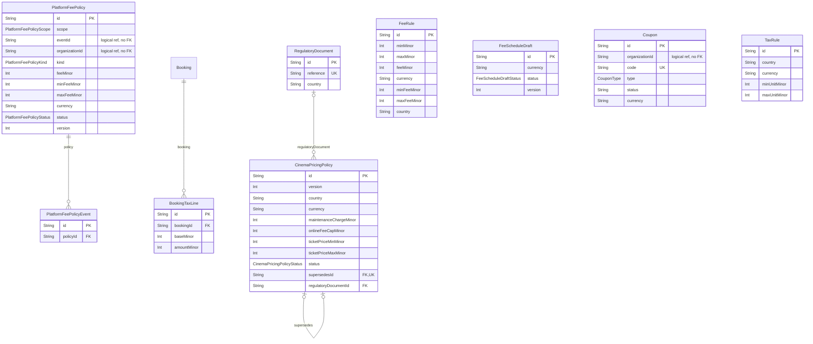

### Bookings, tickets and check-in

Models (18): `Booking`, `BookingItem`, `GuestBookingAccess`, `BookingReferenceCounter`, `ReadableReferenceCounter`, `BookingWorkflow`, `BookingCompensation`, `Ticket`, `TicketInvite`, `Receipt`, `ReceiptCounter`, `CheckIn`, `CheckInDevice`, `CheckInManifest`, `OfflineActivation`, `OfflineDrillRun`, `OfflineReconciliationRecord`, `OfflineAlertAck`.

```mermaid
erDiagram
  Event ||--o{ Booking : "event"
  EventSession ||--o{ Booking : "eventSession"
  User |o--o{ Booking : "user"
  User |o--o{ Booking : "cashCollectedBy"
  User |o--o{ Booking : "cashReturnedBy"
  Booking ||--o{ BookingItem : "booking"
  Booking ||--o{ GuestBookingAccess : "booking"
  Booking ||--o{ Ticket : "booking"
  EventSession ||--o{ Ticket : "eventSession"
  User |o--o{ Ticket : "attendeeUser"
  Ticket ||--o{ TicketInvite : "ticket"
  Organization ||--o{ Receipt : "organization"
  Booking ||--o{ Receipt : "booking"
  Refund |o--o| Receipt : "refund"
  Receipt |o--o{ Receipt : "reverses"
  Ticket ||--o{ CheckIn : "ticket"
  EventSession ||--o{ CheckIn : "eventSession"
  User |o--o{ CheckIn : "by"
  Booking {
    String id PK
    String organizationId "logical ref, no FK"
    String eventId FK
    String eventSessionId FK
    String userId FK
    String couponId FK
    String reference UK
    BookingStatus status
    String cashCollectedByUserId FK
    String cashReturnedByUserId FK
    String currency
    Int subtotalMinor
    Int bookingFeeMinor
    Int paymentFeeMinor
    Int discountMinor
    Int customerFeeMinor
  }
  BookingItem {
    String id PK
    String bookingId FK
    BookingItemKind kind
    String ticketTypeId FK
    String addOnId FK
    String bundleId FK
    Int unitPriceMinor
    Int lineTotalMinor
  }
  GuestBookingAccess {
    String id PK
    String bookingId FK
  }
  BookingReferenceCounter {
    String scope PK
  }
  ReadableReferenceCounter {
    String scope PK
  }
  BookingWorkflow {
    String id PK
    String bookingId UK "logical ref, no FK"
    BookingWorkflowState state
    Int version
    String providerStatus
    String allocationAccountingState
  }
  BookingCompensation {
    String id PK
    String bookingId "logical ref, no FK"
    CompensationState state
    Int version
    Int amountMinor
    String currency
  }
  Ticket {
    String id PK
    String bookingId FK
    String ticketTypeId FK
    String eventSessionId FK
    String organizationId "logical ref, no FK"
    TicketStatus status
    String seatId FK
    AttendeeAssignmentStatus assignmentStatus
    String attendeeUserId FK
  }
  TicketInvite {
    String id PK
    String ticketId FK
    String organizationId "logical ref, no FK"
    TicketInviteKind kind
    TicketInviteStatus status
  }
  Receipt {
    String id PK
    ReceiptKind kind
    String organizationId FK
    String bookingId FK
    String refundId FK,UK
    String reversesId FK
    String currency
    Int subtotalMinor
    Int discountMinor
    Int feeMinor
    Int taxMinor
    Int totalMinor
  }
  ReceiptCounter {
    String scope PK
  }
  CheckIn {
    String id PK
    String ticketId FK
    String eventSessionId FK
    String byUserId FK
  }
  CheckInDevice {
    String id PK
    String organizationId "logical ref, no FK"
    String eventId "logical ref, no FK"
    CheckInDeviceStatus status
  }
  CheckInManifest {
    String id PK
    String organizationId "logical ref, no FK"
    String eventId "logical ref, no FK"
    Int version
  }
  OfflineActivation {
    String id PK
    String organizationId "logical ref, no FK"
    String eventId "logical ref, no FK"
    OfflineActivationState state
  }
  OfflineDrillRun {
    String id PK
    String organizationId "logical ref, no FK"
    String eventId "logical ref, no FK"
  }
  OfflineReconciliationRecord {
    String id PK
    String organizationId "logical ref, no FK"
    String eventId "logical ref, no FK"
    String ticketId "logical ref, no FK"
    ReconcileReviewState reviewState
  }
  OfflineAlertAck {
    String id PK
    String organizationId "logical ref, no FK"
  }
```

### Payments, refunds and disputes

Models (12): `Payment`, `PaymentAttempt`, `Refund`, `RefundProviderAttempt`, `Dispute`, `PaymentProviderConfig`, `PaymentRoute`, `MerchantAccount`, `MerchantOnboarding`, `MerchantCertification`, `PromotionRequest`, `ReconciliationDiscrepancy`.

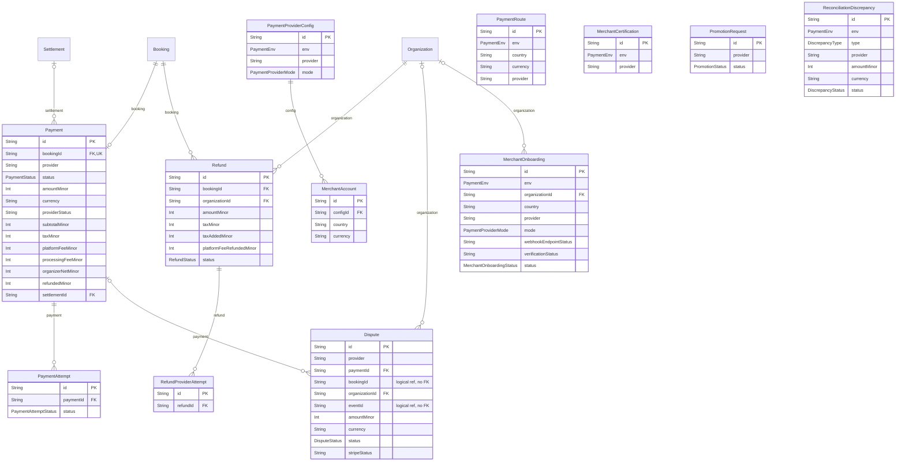

### Settlements, payouts and allocations

Models (10): `Settlement`, `SettlementTransferAttempt`, `SettlementReversalAttempt`, `SettlementReconciliationFinding`, `PayoutAllocation`, `Payout`, `PayoutSetting`, `OrganizerPaymentAccount`, `OrganizerPayoutAccount`, `OrganizerPayoutAccountVersion`.

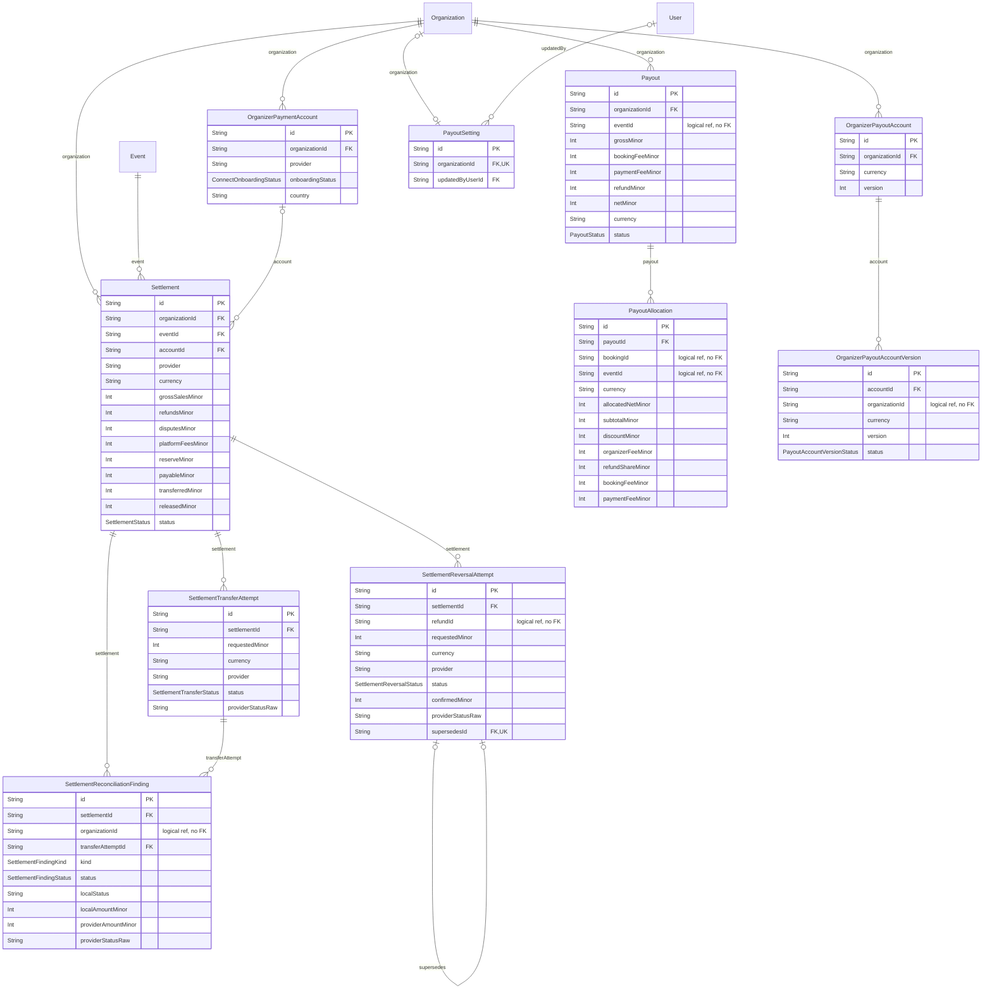

### Notifications, consent and suppression

Models (10): `Notification`, `NotificationDelivery`, `NotificationPreference`, `NotificationRate`, `NotificationCertification`, `SnsPendingConfirmation`, `SuppressedDestination`, `MarketingConsent`, `UserDevice`, `PushSubscription`.

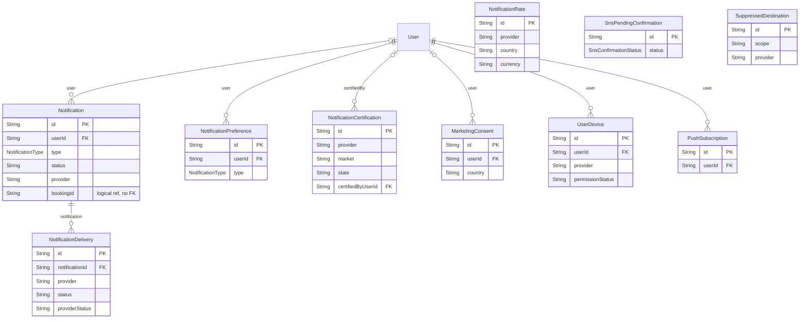

### Growth: follows, audience and campaigns

Models (10): `OrganizerFollow`, `OrganizerNotificationPreference`, `CommunicationConsent`, `OrganizerSuppression`, `SavedSegment`, `Campaign`, `CampaignRecipient`, `CampaignEvent`, `CampaignLink`, `CampaignClick`.

```mermaid
erDiagram
  User ||--o{ OrganizerFollow : "user"
  Organization ||--o{ OrganizerFollow : "organization"
  User ||--o{ OrganizerNotificationPreference : "user"
  Organization ||--o{ OrganizerNotificationPreference : "organization"
  User |o--o{ CommunicationConsent : "user"
  OrganizerFollow {
    String id PK
    String userId FK
    String organizationId FK
  }
  OrganizerNotificationPreference {
    String id PK
    String userId FK
    String organizationId FK
  }
  CommunicationConsent {
    String id PK
    String userId FK
    String organizationId "logical ref, no FK"
  }
  OrganizerSuppression {
    String id PK
    String organizationId "logical ref, no FK"
  }
  SavedSegment {
    String id PK
    String organizationId "logical ref, no FK"
  }
  Campaign {
    String id PK
    String organizationId "logical ref, no FK"
    String eventId "logical ref, no FK"
    CampaignStatus status
    Int version
  }
  CampaignRecipient {
    String id PK
    String campaignId "logical ref, no FK"
    String organizationId "logical ref, no FK"
    String userId "logical ref, no FK"
    CampaignRecipientStatus status
    String provider
  }
  CampaignEvent {
    String id PK
    String campaignId "logical ref, no FK"
    String type
  }
  CampaignLink {
    String id PK
    String campaignId "logical ref, no FK"
  }
  CampaignClick {
    String id PK
    String campaignId "logical ref, no FK"
  }
```

### Organizer billing

Models (13): `BillingPlan`, `BillingPrice`, `PlanEntitlement`, `EntitlementOverride`, `OrganizerBillingAccount`, `OrganizerSubscription`, `OrganizerInvoice`, `BillingPayment`, `BillingAdjustment`, `BillingWebhookEvent`, `UsageLedger`, `CreditPackPrice`, `CreditPackPurchase`.

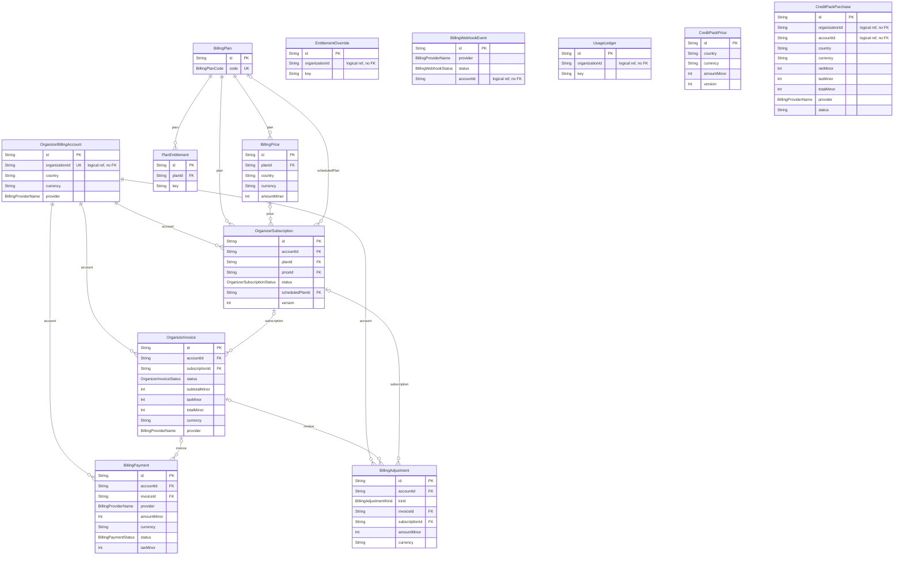

### CRM, admin and audit

Models (9): `CrmTeam`, `CrmTeamMember`, `CrmLead`, `CrmLeadStageChange`, `CrmActivity`, `CrmFollowUp`, `AuditLog`, `Feedback`, `AiUsage`.

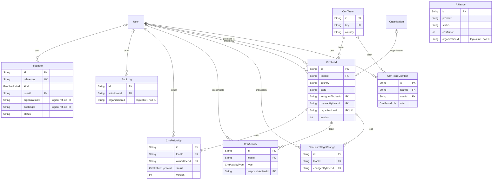

### Outbox, webhooks and idempotency

Models (4): `OutboxEvent`, `ProcessedDomainEvent`, `WebhookEvent`, `IdempotencyRecord`.

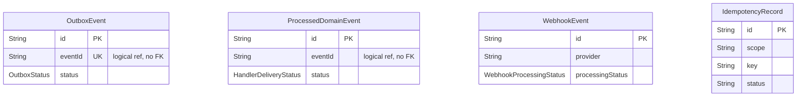

## 2. Key state machines

Enum values are copied from `schema.prisma`. A state diagram is drawn only where the code holds
an explicit transition table or a pure transition function. Where the code has no table, the
services enforce the moves with guarded writes (`updateMany ... where: { status: <expected> }`),
and the section says so.

### 2.1 Booking (`BookingStatus`)

`PENDING_PAYMENT, CONFIRMED, PARTIALLY_REFUNDED, REFUNDED, CANCELLED, EXPIRED, DISPUTED`

There is no transition table for `BookingStatus`. Guarded writes in
`apps/api/src/bookings/bookings.service.ts`, `apps/api/src/payments/payments.service.ts` and
`apps/api/src/refunds/refunds.service.ts` enforce the moves. The internal orchestration
workflow (`BookingWorkflowState`, model `BookingWorkflow`) does have a table:
`apps/api/src/bookings/orchestration/booking-workflow.transitions.ts`, documented in
[BOOKING-STATE-TRANSITION-MATRIX](BOOKING-STATE-TRANSITION-MATRIX.md). The orchestrator is off
by default (`BOOKING_ORCHESTRATOR_ENABLED`, `BOOKING_ORCHESTRATOR_MODE=shadow`).

### 2.2 Payment (`PaymentStatus`) and refund (`RefundStatus`)

- `PaymentStatus`: `REQUIRES_PAYMENT, PROCESSING, AUTHORIZED, SUCCEEDED, FAILED, VOIDED, REFUNDED, PARTIALLY_REFUNDED`
- `PaymentAttemptStatus` tracks each provider attempt separately (model `PaymentAttempt`).
- `RefundStatus`: `REQUESTED, APPROVED, REJECTED, PROCESSING, COMPLETED, FAILED`
- `DisputeStatus`: `NEEDS_RESPONSE, UNDER_REVIEW, WON, LOST, WARNING_CLOSED, CLOSED`

There is no transition table for these. Guarded writes in the payment and refund services and
the webhook processor (`apps/api/src/payments/webhooks/`) enforce the moves. A refund is
claimed atomically before the provider is called, and each provider call is a
`RefundProviderAttempt` row.

### 2.3 Settlement (`SettlementStatus`)

Table: `SETTLEMENT_TRANSITIONS` in `packages/shared-types/src/marketplace.ts`.

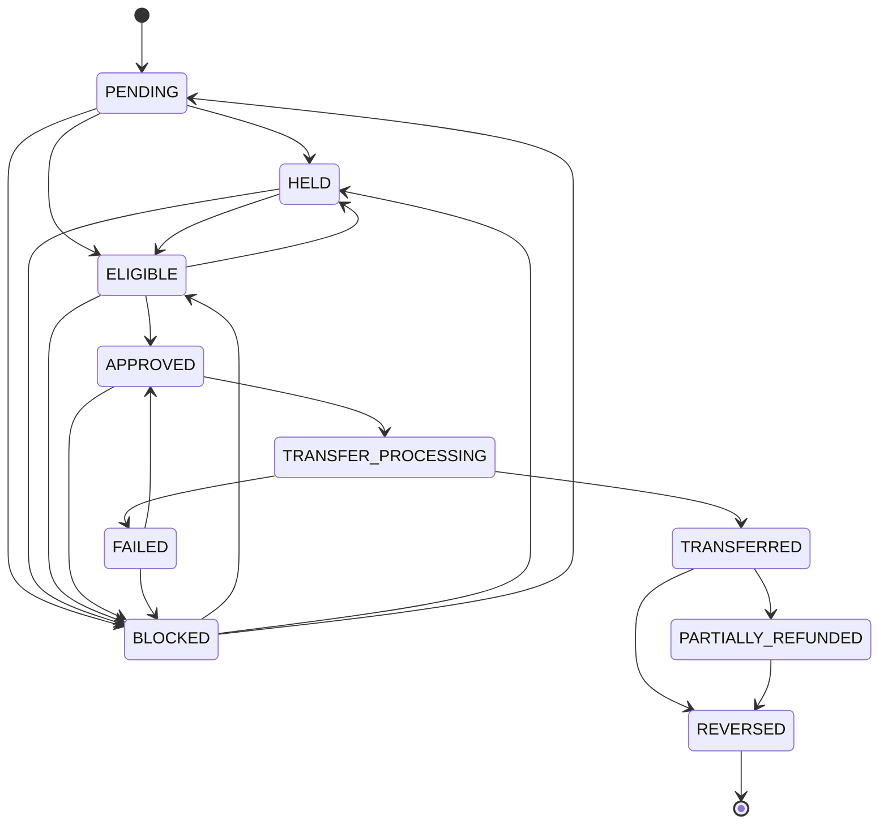

Unverified: no code path was found that writes `PARTIALLY_REFUNDED` or `REVERSED`. A refund
after transfer changes the amounts (`refundsMinor`, `transferredMinor`) and creates
`SettlementReversalAttempt` rows; the settlement status itself stays `TRANSFERRED`.

Only `APPROVED` and `FAILED` can be released (`isReleasableSettlementStatus`). The release
service also moves a claimed settlement to `BLOCKED` when a gate refuses (see
[FLOWS](FLOWS.md) section 8).

### 2.4 Settlement reversal (`SettlementReversalStatus`)

Table: `REVERSAL_TRANSITIONS` in `packages/shared-types/src/settlement-reversal.ts`.

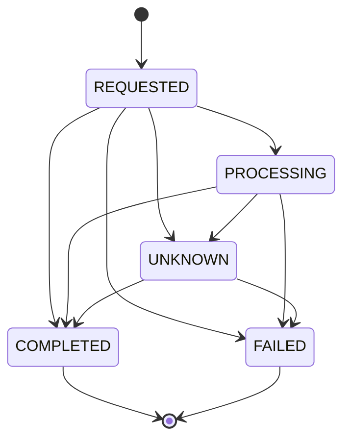

`SettlementTransferStatus` (`REQUESTED, SUCCEEDED, FAILED, UNKNOWN`) has no table. An
exception from the provider is recorded as `UNKNOWN`, never as `FAILED`.

### 2.5 Booking compensation (`CompensationState`)

Table: `ALLOWED_COMPENSATION_TRANSITIONS` in
`apps/api/src/bookings/compensation/compensation-state.ts`.

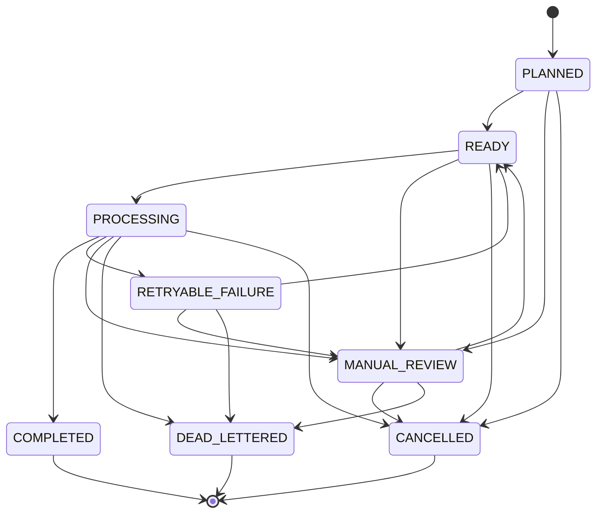

### 2.6 Organizer subscription (`OrganizerSubscriptionStatus`)

Pure function `transition()` in `apps/api/src/billing/subscription-state-machine.ts`.
`ACTIVATE`, `RENEW` and `CHANGE_PLAN_NOW` need verified payment evidence. `CANCELLED` and
`EXPIRED` are terminal: starting again creates a new subscription row.

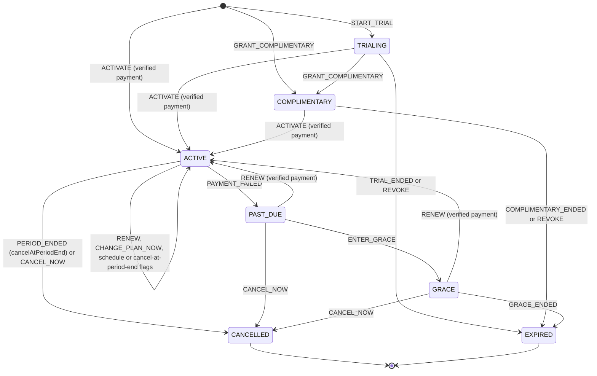

Related enums: `OrganizerInvoiceStatus` (`DRAFT, OPEN, PAID, VOID, REFUNDED`),
`BillingPaymentStatus` (`PENDING, SUCCEEDED, FAILED, REFUNDED`), `BillingWebhookStatus`
(`RECEIVED, PROCESSED, IGNORED, FAILED`).

### 2.7 Fee schedule draft (`FeeScheduleDraftStatus`)

`OPEN, PUBLISHED, DISCARDED`. One `OPEN` draft per currency. `version` is set only on publish
and is unique per currency. Service: `apps/api/src/admin/fee-schedules.service.ts`.

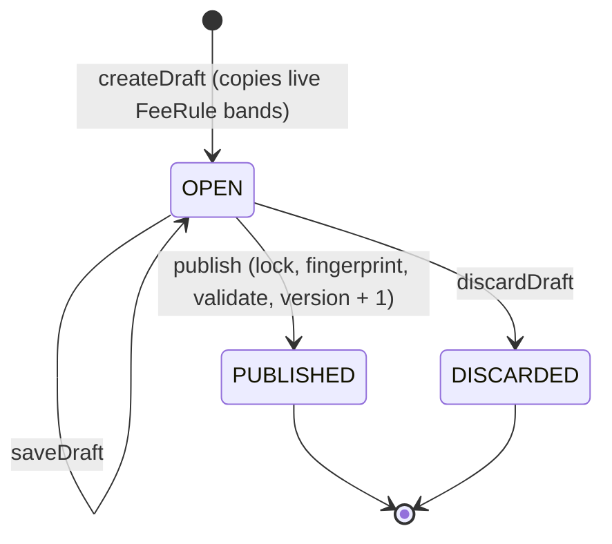

### 2.8 Other status enums worth knowing

- `OutboxStatus`: `PENDING, PROCESSING, DELIVERED, RETRYABLE_FAILURE, DEAD_LETTERED, MANUAL_REVIEW, CANCELLED`
- `WebhookProcessingStatus` (ticket payment webhooks): `RECEIVED, PROCESSING, PROCESSED, FAILED, DEAD_LETTER, IGNORED, AWAITING_CORRELATION`
- `TicketStatus`: `ACTIVE, TRANSFERRED, CHECKED_IN, CANCELLED, REFUNDED, VOID`
- `PayoutStatus` (ledger rows, not provider transfers): `PENDING, SCHEDULED, PAID, FAILED`
- `CampaignStatus`: `DRAFT, SCHEDULED, PENDING_APPROVAL, QUEUED, SENDING, PAUSED, COMPLETED, PARTIALLY_FAILED, FAILED, CANCELLED` (`PENDING_APPROVAL` exists in `apps/api/src/campaigns/campaign-state.ts`, but no route uses it yet)
- `CampaignRecipientStatus`: `PENDING, SKIPPED_CONSENT, SKIPPED_SUPPRESSED, QUEUED, ACCEPTED, DELIVERED, DEFERRED, BOUNCED, COMPLAINED, FAILED, UNSUBSCRIBED`
- `PlatformFeePolicyStatus`: `ACTIVE, INACTIVE, EXPIRED, EXHAUSTED`
- `Role`: `CUSTOMER, ORGANIZER_OWNER, ORGANIZER_MANAGER, CHECKIN_STAFF, ADMIN, SUPER_ADMIN`
