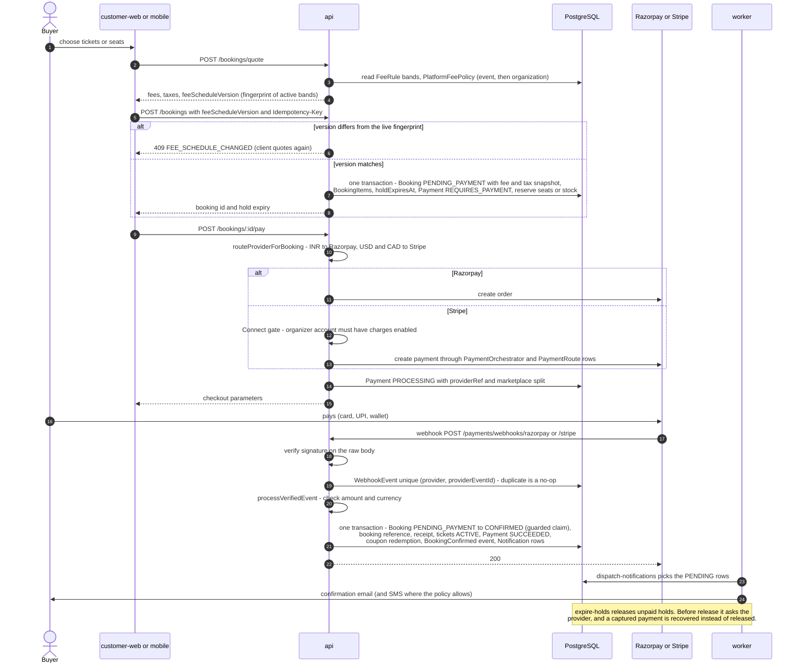
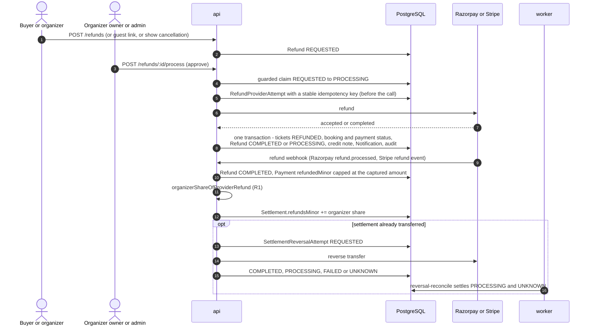
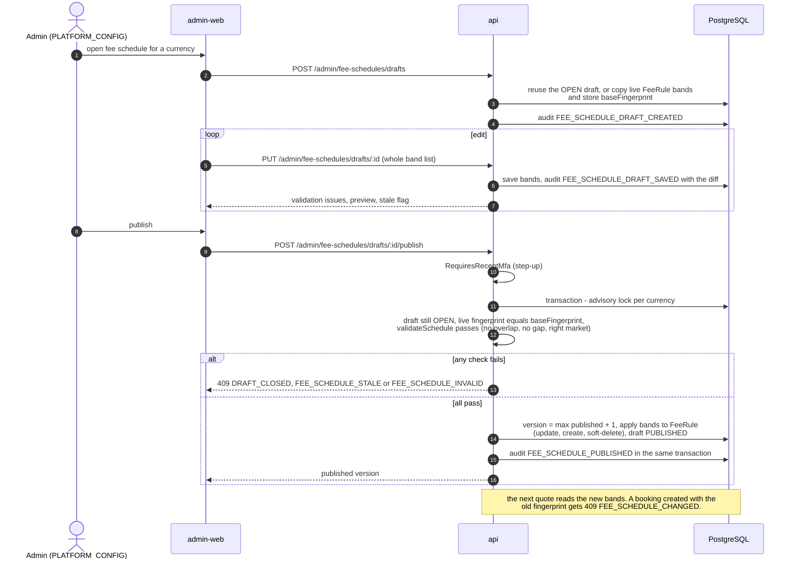
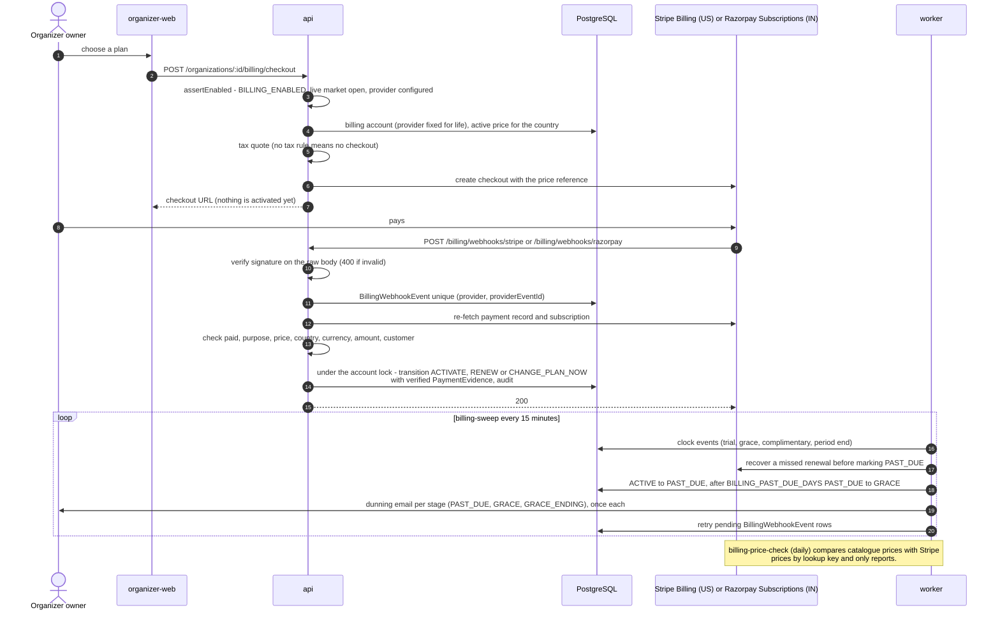
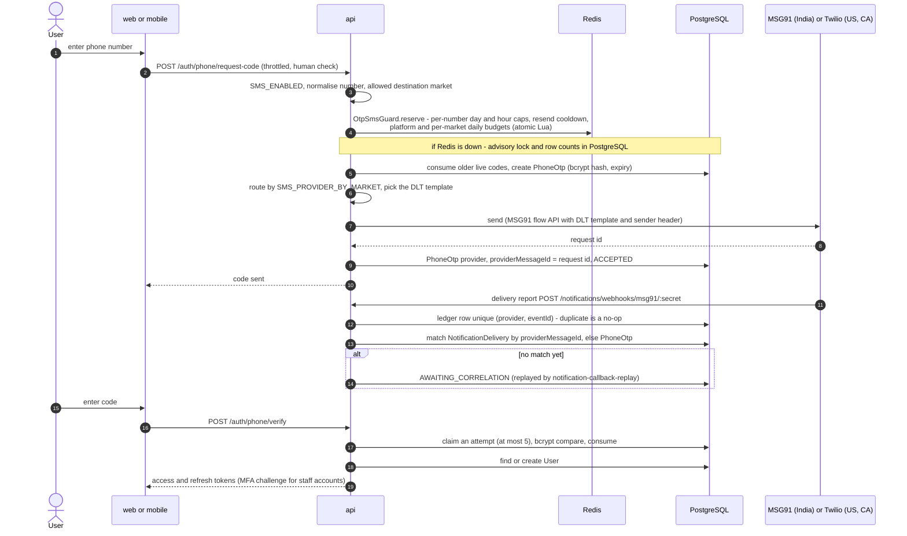
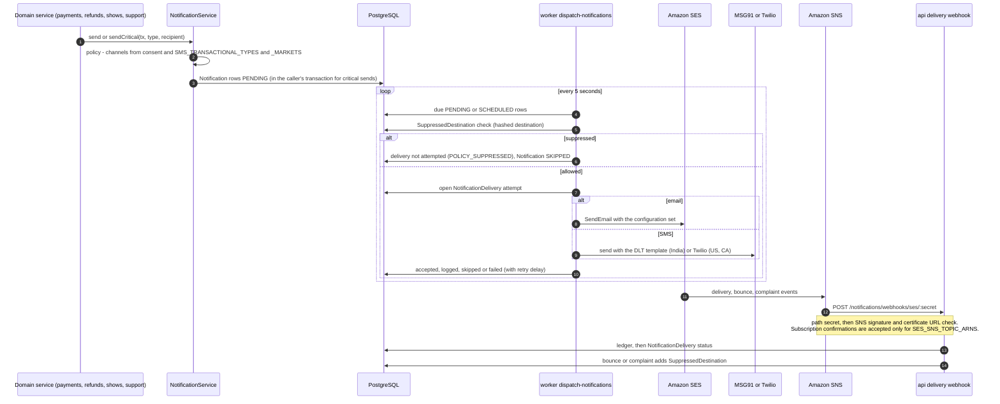
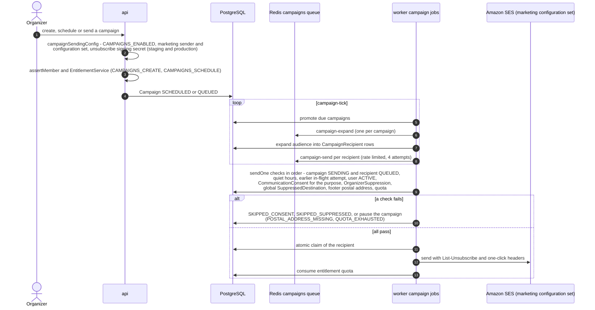
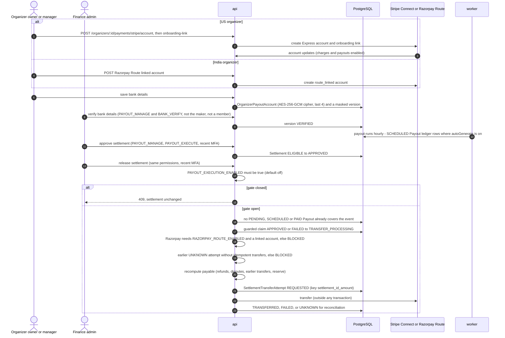

# ETicketsGo: Key Flows (as built)

Status: current reference, written 2026-11-01 against `main` at `d5144d3f`. Each diagram was
traced from the code. The files are listed under each diagram. Paths without a prefix are under
`apps/api/src/`. Steps marked "unverified" were not traced to the end.

Older diagrams in [docs/diagrams/SEQUENCE-DIAGRAMS.md](../diagrams/SEQUENCE-DIAGRAMS.md) show
the July 2026 mock-payment design. Use this file for the current behaviour.

Contents:

1. [Ticket purchase](#1-ticket-purchase)
2. [Refund and the organizer settlement share (R1)](#2-refund-and-the-organizer-settlement-share-r1)
3. [Fee schedule draft, validate, publish](#3-fee-schedule-draft-validate-publish)
4. [Organizer subscription checkout, billing webhooks and dunning](#4-organizer-subscription-checkout-billing-webhooks-and-dunning)
5. [Phone OTP through MSG91 with delivery-report correlation](#5-phone-otp-through-msg91-with-delivery-report-correlation)
6. [Transactional email and SMS with suppression](#6-transactional-email-and-sms-with-suppression)
7. [Marketing campaign send guard](#7-marketing-campaign-send-guard)
8. [Payout onboarding and the transfer gate](#8-payout-onboarding-and-the-transfer-gate)

## 1. Ticket purchase

Files: `bookings/bookings.controller.ts`, `bookings/bookings.service.ts` (`quote`, `create`,
`releaseExpiredHolds`), `pricing/pricing.service.ts` (`resolveFeeTiers`, `loadTiers`),
`pricing/fee-policy-resolver.service.ts`, `pricing/fee-schedule-fingerprint.ts`,
`bookings/orchestration/booking-execution-router.service.ts`,
`bookings/orchestration/local-booking-orchestrator.service.ts`,
`payments/payments.service.ts` (`createIntent`, `processVerifiedEvent`, `confirm`),
`packages/shared-types/src/marketplace.ts` (`routeProviderForBooking`, `CURRENCY_PROVIDERS`),
`payments/razorpay/razorpay-order.service.ts`, `payments/orchestration/payment-orchestrator.service.ts`,
`payments/configuration/payment-routing.ts`, `payments/razorpay/razorpay-webhook.controller.ts`,
`payments/webhooks/stripe/stripe-webhook.controller.ts`,
`payments/recovery/pending-payment-recovery.service.ts`, `apps/worker/src/main.ts`.

Notes:

- The fee-schedule fingerprint is checked at booking time but not stored on `Booking`. The
  booking stores the fee amounts and the applied policy (`feePolicyId`, `feePolicyKind`,
  `feePolicyVersion`, `baseBookingFeeMinor`, `feeWaivedMinor`).
- Free and cash bookings create no `Payment` row.
- Unverified: the exact channel set for `BOOKING_CONFIRMED` per market. The policy is in
  `notifications/policy/`.

## 2. Refund and the organizer settlement share (R1)

**R1 rule.** The organizer's share of a refund is
`max(0, amountMinor - taxAddedMinor - platformFeeRefundedMinor)` when the platform's own
COMPLETED refund rows explain the provider amount exactly. Otherwise (for example a refund made
in the provider dashboard) the share is pro rata: `delta x organizerNetMinor / amountMinor`.
Settlements written before the fix are not recomputed. Payout allocations use the same function:
a refund after a payout becomes a new negative (clawback) `PayoutAllocation`.

Files: `refunds/refunds.service.ts` (`request`, `process`, `payClaimed`),
`refunds/refund-provider-call.ts`, `payments/razorpay/razorpay-webhook.processor.ts`
(`handleRefund`), `payments/webhooks/stripe/stripe-webhook.processor.ts`,
`payments/settlement/refund-organizer-share.ts`, `payouts/currency-settlement.calculator.ts`
(`organizerShareOfRefund`), `payments/settlement/settlement.service.ts` (`applyRefund`,
`reverseIfTransferred`), `payouts/payout-allocation.ts`,
`payments/settlement/refund-organizer-share.integration-postgres.spec.ts` (the R1 test).

## 3. Fee schedule draft, validate, publish

There is no maker-checker on publish: one admin with `PLATFORM_CONFIG` and a recent MFA step-up
can publish. The old per-band endpoints in `admin/admin.controller.ts` return 410 Gone.
`PlatformFeePolicy` is a separate per-event or per-organization override (`WAIVE`, `FIXED`,
`PERCENT`, `COMBINED`, with a time window and an optional order cap), managed at
`/admin/platform-fee-policies`. It wins over the schedule.

Files: `admin/fee-schedules.controller.ts`, `admin/fee-schedules.service.ts`,
`admin/fee-schedule-validation.ts`, `pricing/pricing.service.ts`,
`pricing/fee-policy-resolver.service.ts`,
`apps/api/prisma/migrations/20261030100000_fee_schedule_drafts/migration.sql`.

## 4. Organizer subscription checkout, billing webhooks and dunning

Billing is off in production (`BILLING_ENABLED` unset). The boot gate is described in
[ARCHITECTURE](ARCHITECTURE.md#56-configuration-gates-fail-closed-at-boot). Provider by market:
`US` to Stripe Billing, `IN` to Razorpay Subscriptions, with no fallback between them. Feature
access goes through `@RequiresEntitlement(key)` and `EntitlementService`. Billing provider
setup is described in [docs/billing/BILLING-PROVIDERS.md](../billing/BILLING-PROVIDERS.md).
Unverified: the exact state mapping inside `reconcile()` for status-only provider events.

Files: `billing/billing.controller.ts`, `billing/billing-checkout.service.ts`,
`billing/provider/billing-provider.registry.ts`, `billing/provider/stripe-billing.provider.ts`,
`billing/provider/razorpay-subscriptions.provider.ts`, `billing/billing-webhook.controller.ts`,
`billing/billing-provider-events.service.ts`, `billing/subscription.service.ts`,
`billing/subscription-state-machine.ts`, `billing/billing-sweep.service.ts`,
`billing/billing-dunning.ts`, `billing/billing-price-reconcile.service.ts`,
`billing/entitlements/requires-entitlement.ts`, `config/configuration.ts`
(`billingConfigurationErrors`).

## 5. Phone OTP through MSG91 with delivery-report correlation

The OTP goes straight to the SMS channel and never becomes a `Notification` row, so no stored
row holds the code. The MSG91 callback has no provider signature. A secret path segment
authenticates it (configured in `MSG91_WEBHOOK_SECRET`, never documented with its value).

Files: `auth/auth.controller.ts`, `auth/phone-otp.service.ts`, `auth/otp-destination.ts`,
`auth/otp-sms-guard.ts`, `auth/phone-otp-delivery.sink.ts`,
`notifications/channels/sms.channel.ts`, `notifications/channels/notification-provider.resolver.ts`,
`notifications/channels/transports/sms.transport.ts`, `notifications/templates/dlt-sms-templates.ts`,
`notifications/delivery/webhook/delivery-webhook.controller.ts`,
`notifications/delivery/webhook/delivery-webhook.service.ts`,
`notifications/delivery/webhook/delivery-webhook.parsers.ts`,
`notifications/delivery/delivery-recorder.service.ts`,
`notifications/delivery/webhook/provider-event-replay.service.ts`.

## 6. Transactional email and SMS with suppression

The worker's `notification-fallbacks` job opens a paid fallback channel when the free channels
produced nothing useful after the policy's wait. `notification-callback-replay` re-applies
events that arrived before their delivery row.

Files: `notifications/notification.service.ts` (`send`, `sendCritical`, `fanOutCritical`,
`schedule`, `dispatchDue`, `sweepDue`), `notifications/policy/notification-policy.resolver.ts`,
`notifications/policy/sms-transactional.ts`, `notifications/delivery/suppression.service.ts`,
`notifications/channels/transports/email.transport.ts` (`SesEmailTransport`),
`notifications/delivery/webhook/sns-verifier.ts`,
`notifications/delivery/webhook/sns-confirmation.service.ts`,
`notifications/delivery/webhook/sns-body.middleware.ts`, `notifications/policy/fallback.service.ts`,
`apps/worker/src/main.ts`.

## 7. Marketing campaign send guard

Campaigns are off in production (`CAMPAIGNS_ENABLED` unset). `PENDING_APPROVAL` exists in the
campaign state table, but no route uses it yet. Admin staff can stop a campaign through
`/admin/campaigns` (needs `ORGANIZER_REVIEW`). Unsubscribe pages are `GET` and
`POST /public/unsubscribe/:token`. The send email transport is the log transport unless
`EMAIL_PROVIDER=ses`.

Files: `campaigns/campaign-sending-config.ts`, `campaigns/campaigns.service.ts`,
`campaigns/campaigns.controller.ts`, `campaigns/campaign-state.ts`,
`campaigns/campaign-dispatch.service.ts` (`tick`, `expand`, `sendOne`),
`campaigns/quiet-hours.ts`, `campaigns/campaign-transport.ts`, `engagement/unsubscribe-token.ts`,
`engagement/engagement.controller.ts`, `apps/worker/src/main.ts`.

## 8. Payout onboarding and the transfer gate

Provider transfers are off in production (`PAYOUT_EXECUTION_ENABLED` unset). The standing rule
is that they stay off until the post-transfer checks are proven. `payout-runs` only writes
ledger rows and never moves money.

Files: `payments/connect/organizer-connect.controller.ts`,
`payments/razorpay/razorpay-connect.controller.ts`, `payments/razorpay/razorpay-connect.service.ts`,
`payouts/payout-accounts.service.ts`, `payments/settlement/settlement.controller.ts`,
`payments/settlement/settlement.service.ts` (`release`, `payoutExecutionEnabled`),
`payments/settlement/transfer-reconciliation.service.ts`, `payouts/payout-run.service.ts`,
`apps/api/prisma/schema.prisma` (`OrganizerPayoutAccount`, `SettlementTransferAttempt`).
